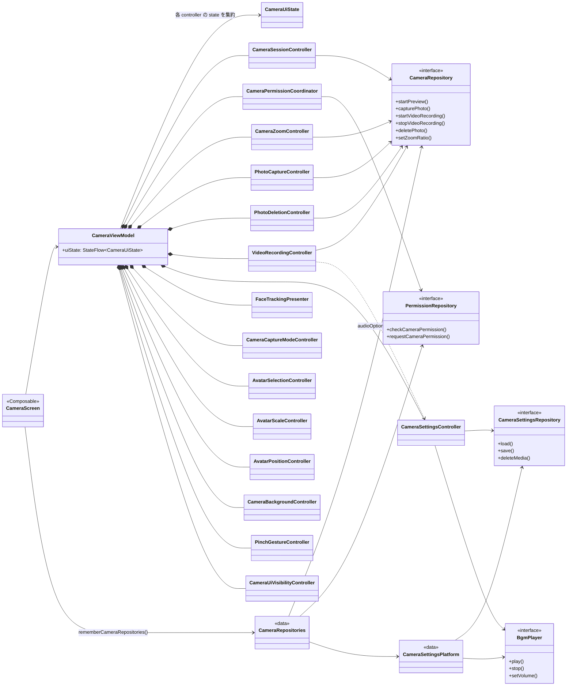
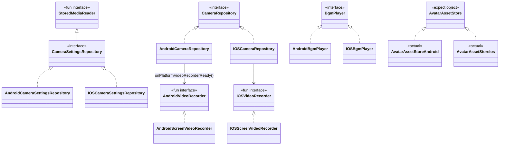
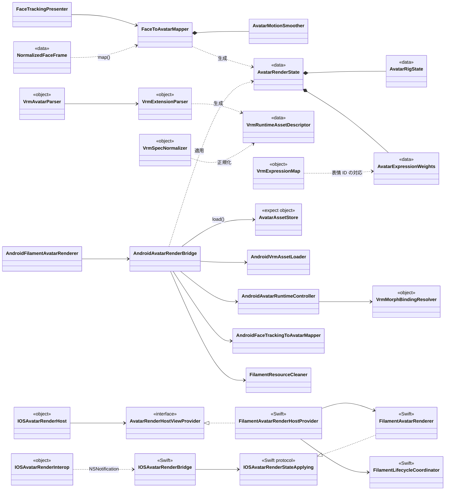

# クラス図

VtuberCamera KMP の主要クラスの関係図（Mermaid）。`commonMain` を中心に、`androidMain` / `iosMain` の実装と iOS(Swift) 側の描画ブリッジを示す。

凡例: `<|..` 実装 / `*--` 所有（ViewModel が生成して保持）/ `-->` 依存・利用

## 1. カメラ画面の全体構成

## 2. プラットフォーム実装（expect/actual・interface 実装）

## 3. アバター描画パイプライン（顔トラッキング → 描画）

